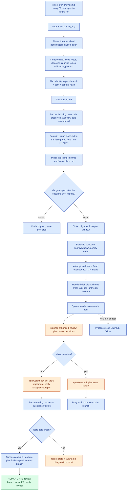

# agentic_scripts

Autonomous workflows that run on this 24/7 server **only when it is idle**. A scheduler gates a
timer-triggered entry point with two gate types: the load-aware **quiet gate** (quiet time window
+ sustained low load) runs mail-keeper/oc-todo/noop only in-window, and the session-based
**idle gate** drives the `roadmap-dev` plan-execution engine (its scan phase runs on **every**
fire; only the execution drain waits for zero OpenCode sessions). Every run is auditable
afterwards.

Workflows plug in as new registered modules — no scheduler changes.

## What / why

- **Goal:** keep this rig doing useful background work (executing approved `work_plan.md` plans
  unattended; resolving `OC-todo:` comments into PRs; triaging the local maildir backup into the
  admin vault) without ever competing with interactive LLM inference or daytime use.
- **How:** a timer (every 30 min) invokes a stateless entry point that checks the gate itself.
  The gate opens only after *two consecutive idle polls* (~30 min apart) — one idle blip must not
  open it. An exclusive file lock means overlapping timer fires are skipped, never double-processed.

## Setup

```bash
git clone <this repo> /workspace/Python/agentic_scripts   # already here on this machine
cd /workspace/Python/agentic_scripts
bash scripts/setup.sh
```

`setup.sh` is idempotent and safe to re-run (it is also the documented recovery after a container
restart, because this container has no init system to restart cron for us). It:

1. syncs the `uv` environment (runtime + the `dev` extra — `uv sync --extra dev`);
2. checks `GITHUB_PAT` (warns if missing; required only by workflows that open PRs);
3. verifies the `admin_repo` clone from the config (needed by mail-keeper);
4. verifies the global OpenCode agent for every *enabled* workflow that declares one
   (`~/.config/opencode/agents/<name>.md`; base-only state with `noop` passes trivially);
5. creates the runtime dirs (`state/`, `logs/`, `sandbox/`);
6. installs the 30-minute timer — via systemd on real hosts, or cron in this container
   (installs the `cron` package if absent and starts the daemon).

Exit code `0` iff every step printed `[OK]` (a missing `GITHUB_PAT` is a `[WARN]`, not a failure).

## Configuration

Single declarative file: `config/workflows.yaml`. Validated at start-up with fail-fast,
human-readable errors naming the offending field.

### Machine section

| Key | Default | Meaning |
|-----|---------|---------|
| `machine.quiet_window.start` / `.end` | `22:00` / `08:00` | Quiet window (crosses midnight; `start > end`). |
| `machine.load_threshold` | `2.0` | 1-min load average must be **strictly below** this. |
| `machine.poll_interval_minutes` | `30` | Timer cadence; also the gate's poll-spacing reference. |
| `machine.gate_polls_required` | `2` | Consecutive idle polls needed to open the gate (`1` opens on the first). |
| `machine.gate_poll_tolerance_minutes` | `10` | Slack allowed between two idle polls (so a 35-min gap still counts). |

### Paths section

Absolute paths, resolved by the config loader. All three are gitignored:

- `paths.state_dir` — durable per-workflow state (JSON), consulted before any action.
- `paths.log_dir` — per-run logs + the `last-run.txt` summary.
- `paths.sandbox_dir` — scratch area for workflow work.

### Agent section

`agent.model`, `agent.steps` — defaults for the shared agent-runner wrapper (the `steps` cap is
the sanctioned stop-and-report budget knob; OpenCode has no native token budget).

### Workflows section

Ordered mapping of registered workflows. Each entry:

- `enabled` — whether the scheduler runs it;
- `module` — dotted Python module exposing a `create(config) -> Workflow`;
- `agent` — global OpenCode agent name, or `null` for non-agent workflows (e.g. `noop`);
- `gate` — optional gate type: omitted = the quiet gate (default), `idle` = the session-based
  idle gate (only `roadmap-dev` uses it; see its section).

**Adding a workflow = write a new module + add an entry here.** No scheduler changes.

## Environment variables

| Var | Required | Purpose |
|-----|----------|---------|
| `GITHUB_PAT` | by PR-opening workflows only | GitHub personal access token for opening PRs. Lives in `.env` (0600) or the environment — never in the config file or git. |

`.env.example` is committed; `setup.sh` creates a 0600 `.env` from it if absent.

## Running

```bash
uv run agentic-scripts run                 # gate-checked (the timer path)
uv run agentic-scripts run --force         # bypass the gate (operator override / smoke test)
uv run agentic-scripts run --only noop     # run a single workflow by name
uv run agentic-scripts run --verbose       # DEBUG-level console output
uv run agentic-scripts run --config PATH   # alternate config file
```

Exit-code contract: `0` = ran, skipped (lock held), or gate-closed; `2` = config/usage fault.
Per-workflow failures are logged and never change the exit code — the next poll retries, and state
is consulted before acting, so a retry is safe.

> ⚠️ **Runbook:** with `roadmap-dev` enabled, **every** `agentic-scripts run` invocation — cron
> fire or manual, `--only` or not — runs its **real** phase 1 (scan all allowed repos + reconcile
> and push `plans.md` to `main` of the listing repo), and drains approved plans for real the
> moment the idle gate is open. `--force` bypasses *both* gates. See the roadmap-dev section's
> warning before any manual run.

## Timer

- **This container (no systemd):** cron entry `*/30 * * * * cd <root> && uv run agentic-scripts run >> logs/cron.log 2>&1`.
- **Real hosts:** the shipped `systemd/agentic-scripts.{service,timer}` units (rendered by
  `setup.sh`, which substitutes the repo root).

To (re)install the timer, just re-run `bash scripts/setup.sh` — it detects systemd vs cron and is
idempotent. **After a container restart**, re-running setup is required: the cron daemon does not
survive it (no init system here).

## Logs

- `logs/run-<run_id>.log` — full per-run log (INFO file level), one file per run.
- `logs/last-run.txt` — short human-readable summary, always overwritten:

  ```
  run: 20261020T220001Z
  trigger: gate            # or: force
  gate: CLOSED now=... load1=13.43 threshold=2.0 window=closed reason=load above threshold
  workflows: -             # e.g. noop=ok(0 items, 1 action, 0 errors)
  overall: skipped         # or: ok / error
  ```

## Smoke test

Hermetic end-to-end proof of the base paths — gate-closed no-op, forced open run, two-step gate
opening, lock exclusivity, audit outputs, and idempotent re-runs. All clock/load inputs are
injected; no real `opencode`, no real repos, no network.

```bash
uv run pytest tests/smoke/ -v
```

## Mail-keeper workflow

The `mail-keeper` workflow triages the local maildir backup into the admin vault on every
gate-open run: it verifies index freshness (canary), detects new mail since the per-folder
cursors, invokes the `mail-keeper` agent exactly once with a ≤10-message manifest, and — only
on an `ok` agent result — records the triage in the processed log, advances the cursors, and
verifies the mail backup tree is byte-identical before and after. The agent performs the
provenance-tagged vault fills, local drafts (never sent), and its own `OC:` commit + push to
the vault's current branch.

On **first runs** the workflow starts the user-confirmed **history backfill**, processing
history **newest-first**: the first run triages the 10 NEWEST messages of the past year, and
every later run fills its `MAX_BATCH = 10` batch with new mail first, then history
newest-first. A fixed **1-year floor** (captured at first run as `first-run-now − 365 d`) is
stored in state; mail older than the floor is never triaged. Each folder's backfill completes
when its frontier reaches the floor — after that it runs in steady state (new-mail-only, fast).
Measured against the live index (13,160 messages; 2025: 2,813 / 2026: 2,980, read-only counts
taken 2026-10-23), the in-window history is ≈3,500 messages ≈ ~350 runs. Pace options: the
overnight quiet-window schedule (≈8–10 runs/night) completes in ≈10–12 weeks, or chained
`--force` runs (≈10/hour) in ≈2 weeks. Newly arriving mail is **never starved** while the
backfill is in flight. Per-folder cursors + the processed log make each run idempotent, and
the agent's dedup rule (grep msg-id before every write) makes re-delivery after a failed run
safe.

### Environment variables

| Var | Default | Meaning |
|-----|---------|---------|
| `MAIL_INDEX_DB` | `/workspace/docker/mbsync/notmuch` | notmuch index dir (read-only). |
| `MAIL_MAIL_ROOT` | `/workspace/docker/mbsync/backup` | maildir root (read-only backup). |
| `MAIL_OWNER_ADDRESS` | `yuri.durodie@vub.be` | Owner address; own-mail is excluded from triage (style sampling only). |
| `MAIL_PROCESSED_LOG` | `/workspace/Obsidian/config/email-processing-log.jsonl` | Processed-log path (v1 6-field JSONL schema, one record per triaged message). |

Env wins over the defaults; the workflow reads them at run time. The `mail-search` CLI
(agent-facing) also reads `MAIL_INDEX_DB` from the project `.env`.

### How a run works

1. **Precheck** — `admin_repo` + index must be readable (else `skipped`).
2. **Canary** — disk-vs-index freshness with a 100-message tolerance; on staleness it
   *reports and defers* (never loses mail), continuing the run.
3. **Detection** — per-folder thread search, newest-first walk (notmuch's natural order),
   excluding the PII folder, own-mail, and already-processed ids; a two-boundary cursor
   (`new`/`back`) plus the 1-year floor drive the backfill.
4. **Manifest** — ≤10 messages in merge order (new mail first, then deferred, then history
   newest-first); over-cap entries are deferred (re-injected next run, never starved).
5. **Agent** — one batched `mail-keeper` invocation with the manifest + skill pointer.
6. **On `ok`** — triage-class parse, processed-log append, cursor advance, deferred clear,
   and a before/after backup byte-identity guardrail check.

### Operator commands

```bash
uv run agentic-scripts run --force --only mail-keeper   # manual run (bypasses the gate)
uv run agentic-scripts run                              # scheduled run (gate-checked)
```

Scheduled runs are gated by the quiet window + sustained low load; `--force` bypasses the gate
for manual/accelerated backfill.

### Where outputs live

- Vault: on its current branch (`feature/test` in the fixture world; the operator's branch
  in production). `mail/drafts/` is gitignored (local drafts, never sent).
- Processed log: `MAIL_PROCESSED_LOG` (default `/workspace/Obsidian/config/email-processing-log.jsonl`).
- State: `state/mail-keeper.json` (v2 schema: `{bootstrapped_at, backfill_floor, cursors (two-boundary new/back per folder), deferred}`).

### Guardrails

- **PII folder** (`INBOX/FU-Admin/PhD_applications`) and own-mail are excluded *before* the
  agent is invoked (defense in depth).
- **Backup read-only** + a before/after byte-identity check: any mutation of the mail backup
  tree trips the guardrail and surfaces as an error.
- **No send tooling**: the workflow never sends mail; drafts are local files only.

The agent/skill lives in the global OpenCode config (`~/.config/opencode/agents/mail-keeper.md`
+ `skills/mail-keeper/SKILL.md`). See the high-level plan at
`planning/workflows-mail-keeper/work_plan.md`.

## OC-todo workflow

The `oc-todo` workflow resolves `OC-todo:` markers in configured GitHub repos into reviewable
pull requests on every gate-open run. It scans each repo **across all branches** — a local full
clone plus a per-branch `git grep` (the GitHub code-search API is rejected for this: it only
considers the default branch, caps files at 384 KB, and is rate-limited to 10 req/min — see the
[GitHub REST search docs](https://docs.github.com/en/rest/search/search); a local clone is
deterministic, offline, and branch-complete) — and opens **one reviewable PR per unhandled
`OC-todo:` marker** (strict, case-sensitive canonical form only).

The Python runner owns all git/PR mechanics: clone/fetch, the per-branch scan, per-todo worktree
setup, commit (`OC:` prefix), push of a fresh `oc-todo/<id>` branch, and PR creation. The headless
`oc-todo-resolver` agent only edits code inside its sandboxed worktree — it implements the todo,
removes the marker line (unless a keep-instruction applies), and runs the configured test command.
There is no auto-merge: every PR is reviewed by a human before merging.

### Configuration (`oc_todo.*`)

| Key | Default | Meaning |
|-----|---------|---------|
| `oc_todo.repos` | `[]` | Ordered list of GitHub repos to scan, in `owner/name` form. **Empty = no-op** (nothing to scan). |
| `oc_todo.max_todos_per_repo` | `3` | Maximum number of todos *processed* per repo per run; the rest are deferred to later runs. |
| `oc_todo.test_commands` | `{}` | Optional per-repo test command (e.g. `{ "owner/name": "uv run pytest" }`) the agent must pass before reporting. |
| `oc_todo.repo_urls` | `{}` | Optional clone-URL override per repo (a local path or mirror — the hermetic-test seam). |

### How a run works

1. **Clone-or-fetch** each configured repo into `sandbox/oc-todo/clones/<owner>__<repo>`
   (a PAT, if present, is injected as git-auth env — never argv).
2. **Per-branch scan** every remote branch with `git grep` for the strict `OC-todo:` marker;
   per todo, read the file to detect a keep-instruction.
3. **State diff** against `state/oc-todo.json` (`pr_open` / `failed` / `resolved`) plus an
   existing-PR check by head ref via REST — at most one API call per todo per run.
4. **Per-todo worktree** branched from the branch that contained the marker (transient).
5. **Agent** — one `oc-todo-resolver` invocation with a brief naming the marker, file:line,
   branch, test command, and keep-instruction.
6. **Commit** (`OC:` prefix) + **push** of the fresh `oc-todo/<id>` branch.
7. **PR** — body quotes the marker verbatim (file/line) + the agent's report; no auto-merge.
8. **State persist** (single atomic write, only when changed); caps apply and a failed todo is
   retried on the next gate-open run.

### Idempotency

A re-run never duplicates a PR: state plus the existing-PR check skip any `pr_open` todo whose PR
is still open; a merged PR (marker removed) flips the todo to `resolved`; and a GitHub API outage
never re-creates a PR — an unknown PR state is treated as "skip + note", never a blind retry.

### Keep-instruction

A marker carrying an `oc-original` note (on the marker line or within the following 3 lines) keeps
the comment line verbatim: the todo is implemented but the marker is not removed.

### Operator commands

```bash
uv run agentic-scripts run --force --only oc-todo   # manual run (bypasses the gate)
uv run agentic-scripts run                          # scheduled run (gate-checked)
```

### Where outputs live

- PRs: on GitHub, one per resolved todo (review before merging).
- Clones: `sandbox/oc-todo/clones/<owner>__<repo>` (full local clones).
- Worktrees: transient, under `sandbox/oc-todo/wt/` (removed after each todo).
- State: `state/oc-todo.json` (v1 schema: `{version, todos: {<todo_id>: entry}}`; one entry per
  todo id with its status `pr_open` / `failed` / `resolved`).

### Guardrails

- **Fresh-branch-only pushes** — every pushed branch is a freshly created `oc-todo/<12-hex>`; no
  protected or pre-existing branch is ever pushed.
- **Caps** — per-repo per-run todo cap + the agent's step cap + a hard timeout bound each run.
- **Per-todo failure → `failed` state**, retried on the next gate-open run (never a partial push).
- **API-outage guardrail** — an unknown PR state is skipped with a note, never re-created blindly.
- **Agent Blockers gate** — no PR is opened unless the agent's report carries no blockers.
- **One PR per todo** for human review; no auto-merge.
- **`GITHUB_PAT`** is required only when repos are configured (see the environment-variable table).

> **First run:** the shipped config has an empty `oc_todo.repos` list, so the workflow is a no-op
> until repos are added.

The agent/skill lives in the global OpenCode config (`~/.config/opencode/agents/oc-todo-resolver.md`
+ `skills/oc-todo-resolver/SKILL.md`). See the high-level plan at
`planning/workflows-oc-todo/workflows-oc-todo_plan.md`.

## Roadmap-dev workflow

### Overview

The `roadmap-dev` workflow turns the rig into an unattended plan-execution engine, running
**from this repo**. On every 30-minute fire it scans the allowed repos for reviewed plans that
are not archived, and — whenever the box is idle (no interactive OpenCode sessions, day or
night) — keeps its execution slots continuously full, each job a headless `planner-enhanced`
run that executes one approved plan strictly sequentially via `@lightweight-dev`. Delivery is a
pushed attempt branch (`roadmap-dev/<id>-<n>`, carrying the implementation + the archived plan
folder) that a human opens as a PR and verifies — the workflow itself never creates PRs. The
live listing (`plans.md` on `main` of `y2d2/agentic_scripts`, i.e. this repo's `main`) is the
operator surface: state, priority, and approval at a glance; a mirror of it is also kept at this
repo's root (`plans.md`) for local reading.

> ⚠️ **Runbook warning:** `roadmap-dev` is enabled with `gate: idle`, so **any**
> `uv run agentic-scripts run` invocation on this tree — cron fire, manual, `--only`, the lot —
> fires it **for real**: phase 1 (scan all allowed repos + reconcile and push `plans.md` to
> `main` of the listing repo) runs on *every* fire regardless of any gate, and the drain starts
> executing ☑-approved plans the moment the idle gate opens (zero OpenCode sessions over two
> consecutive polls). `--force` bypasses both gates and can start multi-hour jobs. Safe manual
> runs are only safe while your own interactive sessions keep the idle gate CLOSED. The test
> suite is guarded by `conftest.strip_live_repo_workflows`, which strips the live workflow set
> from every fixture config so no test fire can reach GitHub or the real listing.

### Configuration (`roadmap_prompts.*` + `workflows.roadmap-dev`)

| Key | Default | Meaning |
|-----|---------|---------|
| `roadmap_prompts.allowed_repos` | `[]` | Ordered list of GitHub repos to scan for un-archived plans, in `owner/name` form. **Empty = no-op** (nothing to scan). |
| `roadmap_prompts.listing_repo` | *(required)* | The live plan-listing repo (`owner/name` form) — home of `plans.md`; required whenever the section is present. This repo sets `y2d2/agentic_scripts`. |
| `roadmap_prompts.listing_repo_url` | `""` | Optional clone-URL override for the listing repo (a local path or mirror — the hermetic-test seam); `""` derives `git@github.com:<listing_repo>.git`. |
| `roadmap_prompts.listing_path` | `plans.md` | The listing file inside the listing repo. |
| `roadmap_prompts.listing_branch` | `main` | The branch holding the listing. |
| `roadmap_prompts.local_listing` | `plans.md` | Also mirror the listing into `<project root>/plans.md` (a relative path resolves against the project root); `null` disables the mirror. Workflow→user only: edits made in the mirror take effect once committed + pushed to the listing repo. |
| `roadmap_prompts.run_timeout_minutes` | `480` | Per-job hard timeout (8 h) for one execution run; expiry is a process-group kill → `failure`. |
| `roadmap_prompts.test_commands` | `{}` | Optional per-repo test command (keys must be in `allowed_repos`) the executing agent must pass. |
| `roadmap_prompts.repo_urls` | `{}` | Optional per-repo clone-URL override (a local path or mirror — the hermetic-test seam). |

The `workflows.roadmap-dev` entry adds `agent: planner-enhanced` and `gate: idle` — a
per-workflow gate type (existing workflows keep the quiet-window gate, unchanged). The
**idle gate** is open iff the shared OpenCode service reports **zero active interactive
sessions** (`GET /api/session/active`, Basic auth from
`~/.local/state/opencode/service.json`), day or night, under the same
two-consecutive-polls rule as the quiet gate (separate state key `idle_gate_last_ok`) —
so ~30–60 min of sustained idle precede any start. Worker runs use
`opencode run --standalone` and are invisible to the probe **by construction**; a probe
failure is treated as *idle* (logged at WARNING). Phase 1 (scan + listing reconcile)
runs on every fire regardless of the gate; only the drain is gated.

### The pipeline

One fire, from timer to human merge (blue = deterministic script, orange = LLM agent work,
green = the human PR gate):



### How a run works

1. **Phase 1 — scan + reconcile** (every fire): the reaper first (orphaned `pending`
   entries — crash/box-restart — flip back to `open`, their worktrees are cleaned up),
   then per allowed repo: clone-or-fetch into `sandbox/roadmap-dev/clones/<owner>__<name>`
   and scan **every remote branch** (the workflow's own `roadmap-dev/*` attempt branches
   are skipped) for `planning/<topic>/work_plan.md` outside `planning/archived/`.
   `plans.md` is then reconciled — new plans appear as `open` rows (workflow-owned
   `title`/`state` cells refresh from the scan; user-owned `approval`/`priority`/`remove`
   cells are never clobbered), a `success` row with `remove` ☑ drops on the next scan,
   and rows whose plan vanished (archived/merged/deleted/edited) reconcile away. The
   reconciled listing is committed + pushed to `main` of the listing repo (one
   non-fast-forward retry: fetch, re-read, re-reconcile), and the final rendered text is
   mirrored to this repo's root `plans.md` whenever it differs (best-effort — the mirror
   never fails a run).
2. **Phase 2 — room check**: the idle gate must be open (see above).
3. **Phase 3 — drain**: while the gate stays open and startable plans remain, the slots
   are kept continuously full — **1 by day, 2 by night** (night = the 22:00–08:00 quiet
   window) — starting the highest-priority ☑-approved `open` / re-☑'d `review` plan into
   each free slot. The moment a job ends, its slot is topped up immediately (re-reading
   the listing first, so the user can re-prioritize between jobs); the scan is re-run
   every 30 min while jobs are in flight; and when the gate closes (user returns), no new
   starts — in-flight jobs finish (let-finish).
4. **Job contract** — one headless `planner-enhanced` run (autonomy brief, 480-min
   timeout) in a worktree on a fresh branch `roadmap-dev/<id>-<attempt>` cut from the
   plan's branch: (1) **review the plan** — a *major* open question (changes scope,
   requirements, or dependencies — NOT implementation detail) is written to
   `planning/<topic>/questions.md` and the report status is `questions`; minor decisions
   are made and recorded by the run itself; (2) otherwise **execute** by dispatching
   `@lightweight-dev` **strictly sequentially, one small self-contained task at a time**,
   verifying each task's acceptance criteria before the next; (3) **report** with an
   explicit `Status:` line. No git by the agent — the runner owns git.
5. **Runner outcomes**: `success` → verify (no blockers, tests green if configured,
   non-empty diff) → commit the implementation + **archive the plan folder** (whole
   folder → `planning/archived/`) → **push the attempt branch** (base = the plan's
   branch) — **NO PR is created; a human opens it and verifies** → state `success`.
   `questions` → `questions.md` as a small `OC:` commit on the **plan's branch** +
   checkmark removed (logged) → state `review`. `failure`/timeout → `failure.md`
   (reason) on the plan's branch → state `failure`. Crash/box-restart → the reaper flips
   the orphaned `pending` back to `open` (infra death ≠ job failure → auto-retry on the
   next drain).

### The listing

`plans.md` (on `main` of the listing repo; mirrored at this repo's root): one `#` section
per repo (repo URL as header), one `##` section per branch, and within each branch one
`###` section per plan — repo/branch are headers, not columns. Each plan renders as its
own `### <plan path>` heading, a six-column data-row table, and a workflow-rendered
three-column `details` checklist (columns `# | details | ✓`: the goal row (`#` is `G`)
followed by one row per task, carrying the plan's own task labels (`1`, `3b`, …); it is
skipped entirely when the plan has neither goal nor tasks, and the engine parses only
the six-cell data rows):

```markdown
# https://github.com/y2d2/ARP_MPE.git
## main
### planning/orbit-sim/work_plan.md
| approval | priority | plan | title | state | remove |
|----------|----------|------|-------|-------|--------|
| ☐ | 1 | planning/orbit-sim/work_plan.md | ORBIT sim extension | open | ☐ |

| # | details | ✓ |
|---|---------|---|
| G | Build the DMP, table-first. | ☐ |
| 1 | Skeleton & front matter | ☑ |
| 2 | Master table | ☐ |
```

| Column | Owner | Meaning |
|--------|-------|---------|
| `approval` | user | The permission to execute — the engine only runs plans you ☑. |
| `priority` | user | Numeric, ascending: 1 = first; ties by row order; new plans get max+1 in their table. |
| `plan` | workflow | Path to `work_plan.md` (identity anchor). |
| `title` | workflow | The plan's title, refreshed from the scan. |
| `state` | workflow | See the state machine below. The one sanctioned user edit: `failure` → `open`. |
| `remove` | user | Valid on `success` rows: the row is dropped on the next scan (reappears as `success` while the attempt branch is unmerged, then disappears for good). |

The `details` table — **including its ✓ column** — is **workflow-owned**: editing it in
`plans.md` is pointless — the next scan rewrites it; the goal/task text still comes from
the plan itself, so editing the plan is the sanctioned way to change what shows.
**Check marks:** a task row flips to ☑ once the plan folder contains its
`lightweight_dev_task_<label>_*.md` result report (the report the dev agent commits when
it completes the task) and stays ☐ before that; the `G` row is ☑ exactly when the plan's
state is `success`. **Identity:** repo + branch + plan-folder path + content hash of
the folder (excluding the workflow-written `questions.md` / `failure.md`) — **an edited
plan is a new plan** (new row, new attempt numbering).

### State machine

| state | meaning | startable |
|---|---|---|
| `open` | discovered, awaiting approval/execution | yes, with ☑ |
| `pending` | job running | no |
| `review` | major questions in `questions.md`; **checkmark removed by the workflow** (logged) | yes, once the user re-☑'s |
| `success` | attempt branch `roadmap-dev/<id>-<n>` pushed (implementation + archived plan folder, base = the plan's branch) — a human opens the PR, verifies, merges | no; removable via `remove` ☑ |
| `failure` | `failure.md` (reason) on the plan's branch; plan not archived | no — re-arm = set the state cell `open` (or edit the plan → new identity → `open`) |

`success`/`failure` are never auto-restarted; a re-appeared `success` row stays
`success` (it is never re-executed). Re-arming a `failure` row — setting its `state`
cell to `open` — is the one sanctioned user edit of a workflow-owned cell.

### Operating the listing

Everything is an edit to `plans.md` (or to the plan's branch), **committed and pushed to
`main` of the listing repo** — the next scan picks it up (a local edit of the root
`plans.md` mirror alone does nothing until pushed):

- **Approve** a plan — ☑ its `approval` cell.
- **Re-prioritize** — change the numeric `priority` (1 = first; ties by row order).
- **Answer a review** — edit `planning/<topic>/questions.md` on the plan's branch,
  commit + push, then re-☑ the row.
- **Re-arm a failure** — set the row's `state` cell to `open`.
- **Remove a success row** — ☑ its `remove` cell.
- **Open a PR** from a pushed attempt branch (human step) — in a local clone of the
  plan's repo, `git checkout roadmap-dev/<id>-<n>` (or the GitHub UI) and open the PR
  (base = the plan's branch); the branch carries the implementation + the archived plan
  folder.
- **Prune** merged attempt branches — `git push origin --delete roadmap-dev/<id>-<n>`
  (manual; the attempt branches are the forensics).
- **Delete a plan folder** — the row reconciles away (the escape hatch for a plan that
  keeps ping-ponging through `review`).
- **Logs** — `logs/run-<run_id>.log` + `logs/last-run.txt` (see the Logs section).

### Where outputs live

- Listing: `plans.md` on `main` of `y2d2/agentic_scripts` (the canonical surface), with a
  best-effort local mirror at this repo's root `plans.md`.
- Attempt branches: on each plan's remote repo — `roadmap-dev/<id>-<n>` (implementation
  + archived plan folder); a human opens the PR from it.
- State: `state/roadmap-dev.json` (machine bookkeeping per plan: identity, state,
  attempt, pid, attempt-branch name, commit sha, last error; saved only when changed).
- Sandbox: `sandbox/roadmap-dev/clones/<owner>__<name>` (full clones),
  `sandbox/roadmap-dev/wt/<owner>__<name>/<identity>` (execution worktrees),
  `sandbox/roadmap-dev/diag/<owner>__<name>/<identity>` (diagnostics worktrees for
  `questions.md`/`failure.md`), `sandbox/roadmap-dev/prompts` (the listing-repo clone).
- Logs: `logs/run-<run_id>.log` + `logs/last-run.txt`.

### Guardrails

- **Allowlist-only scanning** — a repo outside `allowed_repos` is never scanned or
  executed.
- **`success`/`failure` never auto-restart** — re-arm is a human cell edit (or a plan
  edit → new identity); a re-appeared `success` row is never re-executed.
- **No GitHub API, no PR creation** — all git over SSH; PR + merge are human-level
  verification, and the attempt branches are the forensics a human opens as PRs and
  prunes. No `GITHUB_PAT` anywhere in this workflow.
- **User-owned listing cells are never clobbered** — `approval`, `priority`, `remove`,
  and the `failure` → `open` re-arm survive any number of reconciles (a
  non-fast-forward listing push re-reads the remote listing and re-reconciles before
  re-pushing, once).
- **Drain holds the global lock** — while a drain runs (potentially hours), other
  workflow fires and manual `--force` runs skip on the lock until it ends; the drain
  itself re-runs the scan every 30 min, so the listing stays live (accepted risk).
- **8 h per-job hard timeout** — process-group kill; a hang becomes a `failure`, never
  an unbounded loop.
- **Worktrees are always cleaned** — `finally` after each job + the reaper at the next
  run (crash safety).
- **Fresh attempt branches only** — pushes to a plan's remote are freshly created
  `roadmap-dev/<id>-<n>`; diagnostics are small `OC:` commits on the plan's branch (the
  surface the user answers).
- **Test isolation** — the test suite never touches GitHub or the real listing:
  `tests/conftest.py::strip_live_repo_workflows` strips the live workflow set from every
  fixture config, and the tests pin `PROJECT_ROOT` so a fixture run can never write the
  real-tree `plans.md` mirror.

The agent lives in the global OpenCode config
(`~/.config/opencode/agents/planner-enhanced.md`); plan-authoring guidance lives with the
listing itself. See the high-level plan at
`planning/workflows-roadmap-dev/workflows-roadmap-dev_plan.md`.

## Extending with a new workflow

1. Add a module under `src/agentic_scripts/workflows/` exposing `create(config) -> Workflow`.
2. Register it in `config/workflows.yaml` (`enabled`, `module`, `agent`).
3. If it needs an agent, make sure the global OpenCode agent exists
   (`~/.config/opencode/agents/<name>.md`) — `setup.sh` verifies this and fails fast if not.

The scheduler, gate, lock, state, logging, and agent-runner primitives are shared — a workflow
never contains its own timer or lock logic.
