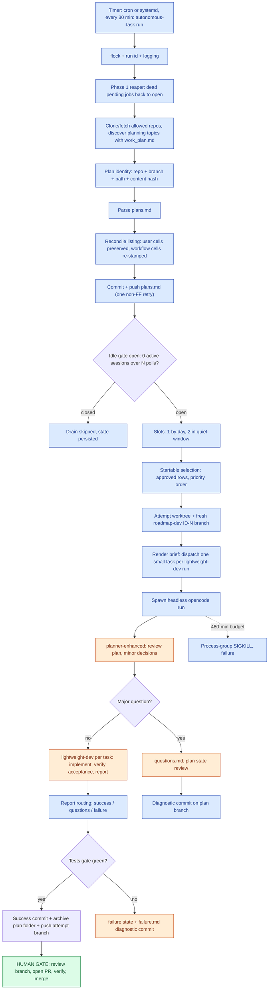

# Task Plan: docs — mermaid pipeline graph + listing-format alignment

**Task:** #2 (depends on Task 1 being complete and green; of a 2-task global plan)
**Session:** planning/listing-detail-row-and-workflow-diagram

## Objective

In `/workspace/Python/autonomous_task_overview`, on the existing branch `feature/listing-detail-row` (check it out; `git pull`): (a) add a mermaid pipeline diagram to `WORKFLOW.md` visualizing the full scripts-vs-LLM split, and (b) align every documentation mention of the listing detail row with Task 1's new per-plan two-table format. Docs only — no source or test logic changes (test suite must stay green untouched).

## Context

- Work ONLY in `/workspace/Python/autonomous_task_overview`, on branch `feature/listing-detail-row` (created by Task 1; already pushed). `OC:`-prefixed commits, `git push`. Never touch `plans.md` or `main`.
- FIRST read (post-Task-1) `src/autonomous_task/workflows/roadmap_dev.py` (`render_listing` + its detail-table helper) and the updated exact-byte tests in `tests/test_roadmap_dev.py` — the doc examples you write must BYTE-match what the code now emits.

### The new listing format (what Task 1 implemented — verify against code)

Per repo (`# <repo_url>`), per branch (`## <branch>`), per plan: `### <plan path>` heading, then its OWN 6-column table (`| approval | priority | plan | title | state | remove |` header + separator + one data row), a blank line, then — only when the plan has goal text or task titles — a single-column details table:

```markdown
### planning/orbit-dmp/work_plan.md
| approval | priority | plan | title | state | remove |
|----------|----------|------|-------|-------|--------|
| ☐ | 1 | planning/orbit-dmp/work_plan.md | Task Plan: ORBIT DMP v0 | open | ☐ |

| details |
|---------|
| **Goal:** Build the DMP, table-first.<br>**Tasks:**<br>1 Skeleton & front matter<br>2 Master table 1 |
```

(The details content line format = `| **Goal:** <goal-or-—><br>**Tasks:**<br><label title><br>… |`; a plan with neither goal nor tasks renders NO details table at all. When writing the README example, copy the REAL bytes from Task 1's exact-byte tests rather than this sketch.)

## Tasks

### Task 1: Mermaid pipeline diagram in WORKFLOW.md
- **Files:** `WORKFLOW.md` (modify — insert a new `## The pipeline at a glance` section directly after the "What this is" section, before "The pipeline split").
- **Do:** Author ONE mermaid `flowchart TD` covering the pipeline table below it, then VERIFY it renders (see acceptance). Skeleton (refine wording, keep structure; the split table in WORKFLOW.md is the source of truth):



  (The `class` assignments are guidance: blue = deterministic script, orange = LLM, green = human; decision diamonds `GATE`, `Q`, `TESTS` are script-evaluated. Keep labels free of `<`, `>`, and double-quote characters — e.g. `roadmap-dev ID-N` not `roadmap-dev/<id>-<n>` — and one node per pipeline stage.)
- **Verify:** try `npx -y @mermaid-js/mermaid-cli -i <(awk mermaid block) -o /tmp/opencode/mermaid_check.png` (or extract the block to a temp .mmd file first; use /tmp/opencode/ for temp files). If npx/mermaid-cli is unavailable or too slow, do a careful line-by-line syntax review (every node first-declared with bracket type, `class` lists only declared ids, `--`/`-.` arrow syntax, no reserved words, balanced quotes) and record which verification was used in the result report.
- **Acceptance:**
  1. `WORKFLOW.md` contains exactly one ` ```mermaid ` fenced `flowchart` covering: timer → phase-1 (reap/scan/discover/hash/parse/reconcile/push) → idle-gate branch (closed = skip drain) → drain (slots/select/worktree/brief/spawn) → LLM review with major-question branch → per-task execution → report routing → tests gate → success (archive + push attempt branch) / failure (diagnostic) / questions (diagnostic) → timeout branch → human PR gate.
  2. Script vs LLM vs human color-coded via `classDef` + `class` statements; legend sentence under the diagram naming the colors.
  3. Diagram verified (mermaid-cli render to /tmp/opencode/ or documented careful review).

### Task 2: Align docs with the new listing format
- **Files:** `WORKFLOW.md`, `README.md`, `VARIABLES.md` (modify).
- **Do:**
  - `WORKFLOW.md` "Listing parse/render" row: mention per-plan `###` sections + the workflow-owned single-column `details` table instead of "the workflow-owned goal/task detail row"; "User-cell-preserving reconcile" row: reword "detail row" → "details table". Add nothing else.
  - `README.md` "The listing" section: replace the sample fenced markdown block (currently one table per branch with `| — | — | **Goal:** … |` detail rows) with the new per-plan structure — TWO plans min, one WITH details, one WITHOUT (no goal, no tasks) to demonstrate the skip rule — byte-matching Task 1's renderer output style from its tests; rewrite the "**Detail row:**" paragraph as "**Per-plan sections:**": `### <plan path>` heading, its own data-row table, and a workflow-rendered single-column `details` table (goal + one `<br>`-separated line per task, derived from `**Purpose:**`/`**Goal:**` and `### Task N:` headings, skipped entirely when there is nothing to show, refreshed every reconcile, not data rows — the engine ignores them; never approve or prioritize on them).
  - `VARIABLES.md` listing-columns row: "(+ the goal/task detail row)" → "(+ the per-plan details table)".
- **Acceptance:**
  1. No mention of the old `| — | — |` detail row remains in the three docs; the README example is byte-consistent with the Task 1 exact-byte tests (compare character-for-character the data-row + details-table lines).
  2. `uv run pytest` from the repo root is still fully green (you changed no code).
  3. Commits `OC:`-prefixed on `feature/listing-detail-row`, pushed.

## Out of Scope

- Any change to `src/`, `tests/`, `plans.md`, `config/`, `systemd/`; the state machine, gate, or drain logic; editing the mermaid diagram's underlying pipeline facts (WORKFLOW.md's split table owns those).

## Notes

- If Task 1's real output deviated from the format quoted here (it shouldn't), the CODE is authoritative — docs follow code.
- The engine rewrites live `plans.md` on the next fire after merge — docs must say the listing is regenerated, never hand-migrated.
- Result report: write `lightweight_dev_task_2_docs_mermaid.md` in `/workspace/Python/agentic_scripts/planning/listing-detail-row-and-workflow-diagram/` per the standard report template (reference your own commit by message, never by SHA).
